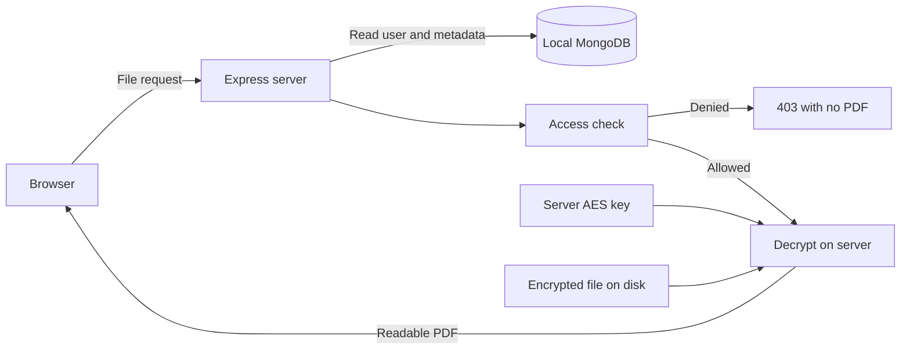

> The sections below describe the normal baseline. The completed ABE design is documented in PROJECT-REPORT.md and PRESENTATION-GUIDE.md.

# Understand the implementation

## Phase 1: scenario and access rules

Each PDF belongs to one student with a unique student ID. Faculty belong to a department. The demo contains two CSE students, one CSE faculty member, and one ECE faculty member.

```text
Allow the sheet's student
OR allow a faculty member from the sheet's department
Otherwise deny
```

These ordinary server-side rules live in `src/security/access.js`. They are not cryptographic ABE policies yet.

## Phase 2: request flow



## Follow an upload

1. `public/app.js` submits a PDF and metadata as multipart form data.
2. `src/app.js` loads the session, validates the CSRF token, and dispatches the request.
3. `src/middleware/auth.js` loads the account from MongoDB and requires faculty status.
4. `src/routes/grade-sheets.js` checks the PDF and the student's department.
5. `src/services/grade-sheets.js` assigns a random file UUID.
6. `src/security/encryption.js` uses AES-256-GCM with a fresh nonce. The file ID is authenticated as additional data, so swapping encrypted envelopes between IDs fails.
7. The service writes a `.enc` package and a MongoDB metadata record. It removes the new file if metadata insertion fails.
8. An audit event is saved and the browser refreshes its record list.

Uploads are buffered in memory with a 5 MB limit. Plaintext is not written to the server's encrypted storage folder. The uploader's original file remains at its original location.

## Follow a download

The route calls `canReadGradeSheet` with the saved database account. A role or student ID supplied by the browser does not determine access. Denied requests get HTTP 403 and no PDF.

Allowed requests read the ciphertext, authenticate its tag, decrypt it, and send the PDF. Missing/damaged encrypted files return HTTP 409 without a PDF. Download outcomes are logged once the requested file is identified.

## The baseline limitation

Express owns the AES key. It can decrypt every file and trusts MongoDB's metadata for authorization. Compromise of the server/key or modification of trusted metadata remains a limitation. A separate key folder on the same machine does not remove that trust.

The future ABE phase needs a key-issuing authority and user attribute keys. Its storage server should not hold every user's decryption key. This baseline does not implement that separation.

## API map

| Route | Purpose and access |
| --- | --- |
| `GET /api/health` | Public connection status |
| `GET /api/auth/csrf` | Session-bound CSRF token |
| `POST /api/auth/login` | Sign in; requires CSRF; rotates session |
| `GET /api/auth/me` | Current signed-in account, excluding password hash |
| `POST /api/auth/logout` | Destroy session; signed in + CSRF |
| `GET /api/students` | Faculty's department students |
| `GET /api/grade-sheets` | Only permitted records |
| `POST /api/grade-sheets` | Upload, validate, encrypt; faculty + CSRF |
| `GET /api/grade-sheets/:fileId/download` | Owner or same-department faculty |
| `GET /api/activity` | Student's own events or faculty's department events |

## Reading order

Read `security/access.js`, then `routes/grade-sheets.js`, `services/grade-sheets.js`, and `security/encryption.js`. `app.js` wires them together. `public/app.js` shows how the interface calls the API.
