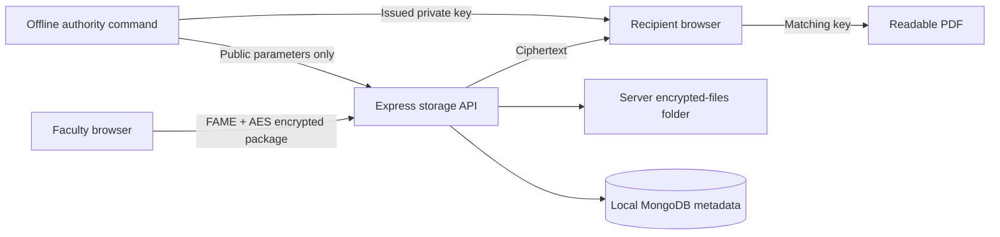

# Secure Academic Data Sharing Using Attribute-Based Encryption

## 1. Abstract

Academic Vault demonstrates secure sharing of individual student grade sheets using Express, Node.js and local MongoDB. A conventional server-controlled implementation is compared with browser-side hybrid encryption using FAME ciphertext-policy attribute-based encryption (CP-ABE) and AES-256-GCM. A policy allows a sheet's student or faculty from the student's department to decrypt. The project includes actual attribute-key issuance, encrypted-only storage for the ABE workflow, positive and negative access tests, and measured computation/storage overhead. It is an educational prototype using synthetic records.

## 2. Introduction and problem definition

A university must share grade sheets with their owners and authorized faculty without making them readable to unrelated students. Login and server-side checks can enforce this, but a server holding all decryption keys must remain trusted. The project investigates moving decryption capability to recipients' attribute keys while keeping a familiar web interface and local storage. Scope is individual grade-sheet PDFs up to 5 MB, two demonstration students and two faculty profiles. It does not calculate grades or make academic decisions.

## 3. Existing system and limitation

The baseline authenticates users with password hashes and MongoDB sessions. Express checks student ownership or faculty department for every file request. Uploaded PDFs are stored with AES-256-GCM encryption and a fresh nonce. The server holds one encryption key and decrypts authorized responses.

This is a working protected baseline: another student cannot bypass it merely by changing a file ID, and copied ciphertext alone is unreadable. Its limitation is the trusted server and its key: obtaining that key or compromising the server's permission enforcement can expose the grade sheets. Roles in MongoDB are ordinary application data, not cryptographic attributes.

## 4. Proposed system and objectives

The proposed workflow gives each person an authority-issued private key with verified attributes. Each PDF gets a fresh AES key. FAME CP-ABE protects that key under a public policy; AES-GCM protects the PDF. Both encryption and decryption execute in a browser WebAssembly worker. Express stores and returns encrypted packages and metadata, without loading ABE private keys.

Example policy: `student_23cs101 OR (role_faculty AND dept_cse)`.

Objectives are to demonstrate policy-based decryption, show failure with a nonmatching key even after ciphertext retrieval, retain normal login/upload controls, and measure the added overhead. The contribution is applying and integrating an existing scheme, not inventing a new cryptographic algorithm.

## 5. Architecture and implementation

The main stack remains Node.js, Express, local MongoDB, and HTML/CSS/JavaScript. The cryptography helper uses the pinned GoFE FAME implementation compiled to WebAssembly. Node.js hosts the offline authority module. A separate browser module exposes only encrypt/decrypt operations. Authority setup and key issuance are not web API endpoints.

The authority verifies the fixed demo profiles before issuing keys. Student A has `role_student`, `dept_cse`, `student_23cs101`; Student B has a different student attribute. CSE faculty has `role_faculty` and `dept_cse`. Issued keys remain in the ignored server-data/abe-user-keys folder and are imported manually into browser memory. They are forgotten on navigation and are not uploaded by the interface.

Server ABE files are `server-data/abe-encrypted-files/<UUID>.abe.json`; public parameters are `server-data/abe/public.json`. MongoDB database `academic_sharing_baseline` contains users, ordinary grade sheets, ABE grade-sheet metadata, audit events and sessions. `abegradesheets` stores file ID, owner, department, semester, title, filename, size and uploader. It contains no plaintext PDF or ABE secret key. Policies and metadata are visible.

For an ABE upload, Express verifies the faculty's department, expected policy, authority fingerprint and envelope size/shape. It cannot prove that a malicious authorized uploader encrypted meaningful PDF content; the client validates its input and recipients authenticate/decrypt locally. Any logged-in demo user may retrieve an ABE package by its UUID. This intentionally demonstrates cryptographic denial independently of server read filtering. The list view remains filtered for convenience.

AES-GCM authenticates the serialized envelope header, including policy, file identity, filename, public-key fingerprint and FAME capsule. GoFE internally uses symmetric encryption within its FAME routine; the wrapper applies outer GCM authentication to the PDF. This project does not claim a new formal security proof or a production security certification.

## 6. Testing and experimental methodology

The Node test suite passes 17 reported tests against real local MongoDB. It checks login/CSRF/authorization, baseline integrity, exact PDF round trips, persistence, ABE upload policies, copied-ciphertext retrieval followed by wrong-key rejection, matching-key success, and absence of plaintext/private keys from the stored package. Tests use isolated temporary databases and folders. Go cryptographic tests cover permitted and denied attributes, altered ciphertext/header/capsule, edited attribute labels, mixed key components, authority mismatch and malformed input.

Browser checks additionally verified a real PDF encrypted/uploaded locally, Student B's key rejected, and Student A's key successfully decrypted the same record. Keeping the faculty login unchanged while changing keys isolates the cryptographic access decision from the login role.

The benchmark compares AES-GCM and FAME-plus-AES-GCM in the same Go WebAssembly runtime hosted in Node.js. It measures synthetic payloads of 1 KB, 100 KB and 1 MB with three policy leaves, plus 1 KB payloads with five and nine leaves. Each case has two warmups and seven measured repetitions. It records mean, median, minimum, maximum and serialized JSON package sizes. Key setup/issuance, network, disk, MongoDB, helper startup and outer envelope JSON serialization are outside the timed regions. The ABE operation includes policy processing and key conversion, so this is an implementation comparison, not an isolated pairing microbenchmark.

## 7. Results and discussion

Full results are in `docs/results/MEASURED-RESULTS.md`, `comparison.csv` and `public/results/benchmark.json`. The comparison webpage reads those actual measurements.

In the recorded run, a 1 MB payload with a three-leaf policy averaged 34.872 ms for baseline encryption and 304.556 ms for ABE hybrid encryption. Decryption averaged 35.483 ms and 195.230 ms respectively. Serialized package sizes were 1,398,219 and 1,400,408 bytes. These are measured crypto-core costs on this environment, not website response times. Baseline Node-native AES and browser execution may perform differently.

At 1 KB, increasing policy leaves from three to nine increased observed ABE encryption from 394.579 ms to 1,497.915 ms and package size from 3,672 to 5,412 bytes. The small sample and runtime warmup/load variation prevent general performance claims; nonmonotonic timings should not be interpreted as larger files being intrinsically faster. Larger policy decryption was not monotonically slower in this run.

The security demonstration succeeds: a copied encrypted package remains unreadable with a nonmatching issued key. ABE adds computation, larger packages and key-distribution responsibilities. Both implementations already encrypt stored files; the improvement is where decryption capability resides and how it is constrained.

## 8. Conclusion, limitations and future scope

The implementation meets the prototype objective: an ordinary baseline and a real CP-ABE workflow operate on the same grade-sheet scenario, with tested authorized/unauthorized behavior and reproducible measurements.

This is one-laptop logical separation. The current OS account can access project secrets; the storage server is not isolated from an administrator of that machine. The authority, recipient device and browser-delivered application code must be trusted. A malicious server replacing JavaScript could steal imported keys. GoFE is research software, and no production-grade or 128-bit-security claim is made. Metadata is not encrypted. Possession of a shared/stolen valid user key grants its decryption capabilities. ABE access changes do not revoke old issued keys or previously downloaded packages. Plaintext already downloaded cannot be recalled.

Future work includes reviewed cryptographic dependencies, separately distributed trusted clients, OS/service isolation, authenticated deployment, secure key distribution and storage, key revocation/re-encryption, richer policies, larger repeated experiments, and administrative interfaces.

## 9. References

- FENTEC GoFE implementation and research references: https://github.com/fentec-project/gofe
- FAME implementation used: https://github.com/fentec-project/gofe/blob/ccc7482d20ef/abe/fame.go
- Local pinned dependencies: `crypto-helper/go.mod` and `crypto-helper/go.sum`.
- Faculty requirements: `instructions/Instructions for Project.pdf`.
- Reproduction instructions: `README.md`, `docs/HOW-TO-CHECK.md`, `docs/VERIFICATION.md`.

Before submission, add your actual team names, roll numbers, department and faculty details. This report describes the implemented prototype and should be formatted into your college's required submission template.
